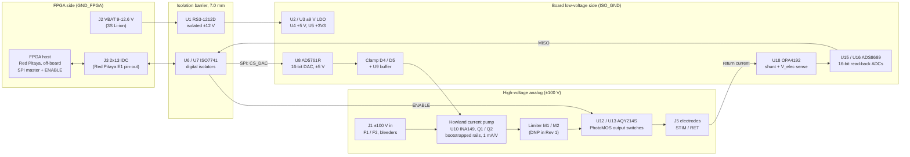
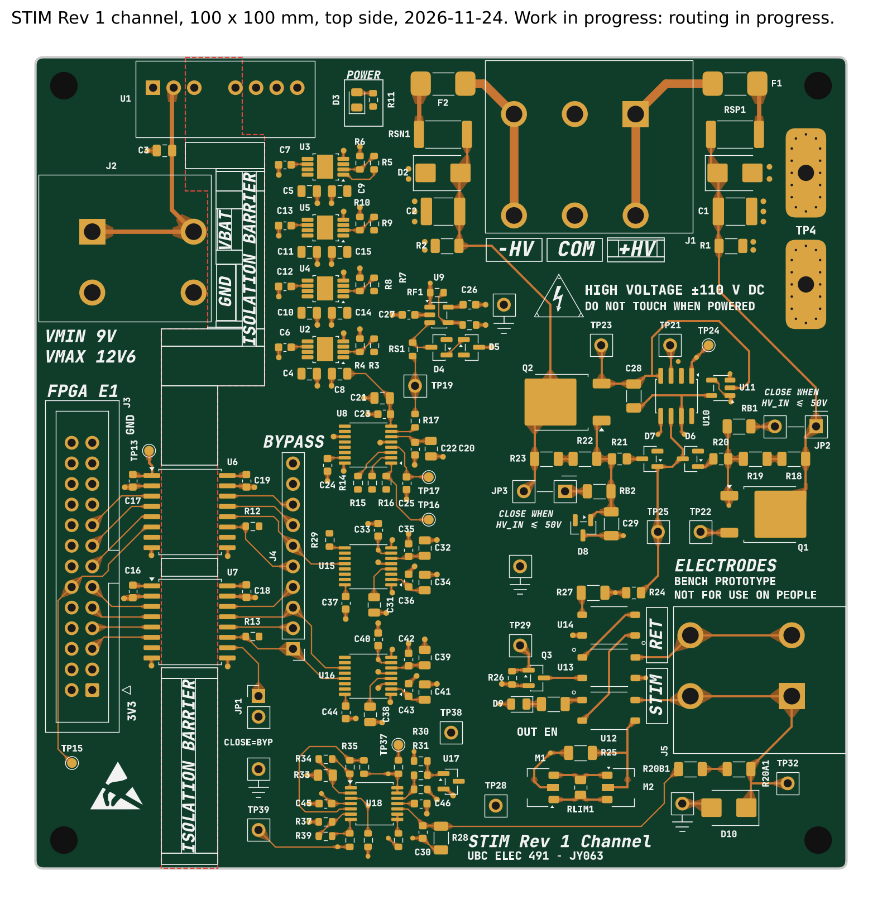

# STIM channel: digitally controlled EVS current-source channel (JY063)

UBC ELEC 491 capstone, project JY063 (Project 63, *Multi-Channel Neural Interface for Immersive Virtual Reality: A
High-Speed Digital Vestibular Stimulation System*), for the UBC Sensorimotor Physiology Laboratory.

## The project

VR motion sickness comes largely from the mismatch between what the eyes see and what the vestibular system in the
inner ear reports about head motion. Electrical vestibular stimulation (EVS), a small current passed through
electrodes on the head, can create the sensation of head motion. The client's existing proof-of-concept is a
single-channel, analog-driven Howland current pump that can only produce roll (side-to-side) cues.

The project turns it into a scalable, digitally controlled multi-channel bench-top stimulator (4, then 8 channels) so
that currents balanced across an electrode array can steer the perceived rotation in pitch, yaw and roll. The main
targets from the project brief:

| Requirement | Target |
|---|---|
| Output current | up to ±5 mA per channel (stretch: 10 mA) |
| Accuracy | delivered current within ±1 % of the commanded current |
| Update rate | ≥ 1 kHz command / update rate, jitter < 100 µs |
| Control | digital (DAC / FPGA) instead of analog voltage inputs |
| Power | integrated battery-operated supply |
| Verification | simulation model before fabrication; bench tests on electronic / dummy loads only (no human testing) |

This repository holds the **hardware of one stimulator channel (STIM Rev 1)**: the working files, simulations, raw
bench data and results. The milestone documents point here for data access, so files are kept as raw and as close to
how they were produced as possible; each folder's README says what is in it and how it was produced.

## Block diagram: STIM Rev 1 channel

## PCB: current state (work in progress)

**Work in progress.** Schematic rev 2.1.0-dev (PRELIMINARY) is complete; the 100 × 100 mm, 4-layer board is placed and
routing is in progress. The image is rendered from `STIM_Rev1.kicad_pcb` as committed in this repository (2026-11-24
snapshot: pads, top-layer tracks and pours, silkscreen of the top side). Rev 1 is a bench prototype for dummy loads only, not a safety sign-off.
**4-channel revamp (started 2026-11-24).** The board is being reorganised into four identical stimulating channels on
shared rails with one always-connected return electrode. The single-channel design is tagged `rev1-1ch-baseline`.
Phase 1 (done): the channel pages ([7] clamp and buffer, [8] Howland pump, [9] limiter and PhotoMOS) sit under one
hierarchical block `channel.kicad_sch` (sheet CH1); no electrical change (same parts, same pin-to-net connections).
Phase 1 fixes (done): per channel a second floating-rail cap (C47, U11), +HV / -HV collector caps (C48 / C49) and a
Kelvin test-loop pair across R24 (TP25 + TP26, 1 V = 1 mA, floats at the electrode voltage).
Phase 2 (done): the channel is placed four times (CH1-CH4, designators R1xx / R2xx / R3xx / R4xx and so on), each
fed from the shared +/-HV through its own 0 ohm links (R150 / R151 ...) and with its own ISO_GND test loop; design
rule "HV channel to channel" keeps 1.5 mm between the floating / output nets of different channels. Until phase 3
each copy still carries the old return-path parts.
Full specification, sheet list and design rules: [`02_rev1_channel/Kicad Projects/STIM_Rev1/README.md`](02_rev1_channel/Kicad%20Projects/STIM_Rev1/README.md).

## Repository map

| Folder | Contents |
|---|---|
| [`01_client_board/`](01_client_board/) | LTspice model of the client's single-channel reference board, one simulation per acceptance test with its raw LTspice output, characterisation deck, bench test plan, lab-equipment capture code, and the bench session records with their raw data |
| [`02_rev1_channel/`](02_rev1_channel/) | STIM Rev 1 KiCad project (schematic, PCB, libraries, BoM, ERC), FPGA interface control document `ICD_J3.md`, backup ±100 V flyback power-stage calculators `PWR_Rev1/` |
| [`03_safety_plan/`](03_safety_plan/) | System architecture and fault-protection deck, Rev 2 safety-loop specification draft, FMEA skeleton, block schematic |
| [`04_demo/`](04_demo/) | Demo scope and deliverables (planning) |
| [`docs/img/`](docs/img/) | Images used by this README |

## Conventions

- **Number tags.** [DS] datasheet, [H] hand calculation, [L] LTspice, [N] ngspice, [B] bench measurement,
  [ASSUME] stated assumption. A value without a tag is a nominal design value.
- **Dates** are ISO (YYYY-MM-DD) and appear in file names where a file is a snapshot (BoM, floorplan, sourcing).
- **Simulations.** Open an `.asc` in LTspice 26.x and run it; all directives are on the sheet and results are written
  to the SPICE error log by `.meas`. The raw outputs (`.raw`, `.log`) of the acceptance-test runs are committed next
  to their schematics.
- **Code.** The only code kept is the lab-equipment capture code in `01_client_board/bench/`; no plotting or
  document-generation scripts.
- **KiCad.** KiCad 10. Install the JetBrains Mono font before opening the board (silkscreen text).

## Contributions and AI-tool use

All engineering work and decisions in this repository are the channel designer's (repository owner) unless listed
below.

| Work | Done by |
|---|---|
| Project plan, test plan and acceptance criteria | channel designer |
| Simulation set-up: circuit models, test benches, stimuli, what to sweep and why | channel designer |
| Schematic, PCB design, layout, routing, design rules | channel designer |
| Part selection (pump, power, protection, switches, connectors) | channel designer |
| Selection of the command DAC (AD5761R), read-back ADCs (ADS8689) and digital isolators (ISO7741) | other JY063 team members |
| Bench work: wiring, power-up, every measurement | channel designer |
| Interpreting results, verifying every result, every engineering decision | channel designer |

**Claude (Anthropic's AI assistant)** was used as a tool to speed up an otherwise time-intensive workflow. Its role
was limited to the repetitive work: running the iterative LTspice sweeps the designer set up and processing the raw
LTspice output into tables and plots; writing and running instrument-control and data-capture scripts; converting raw
bench data, processing plots and entering logged values; and formatting documents and slide decks (`.docx`, `.pptx`),
including the formatting and the written summary of the B0 bench session record. The content of every document and
deck is the designer's. Claude made no engineering decisions. Every result it produced was
reviewed and verified by the designer against the raw data in this repository.
